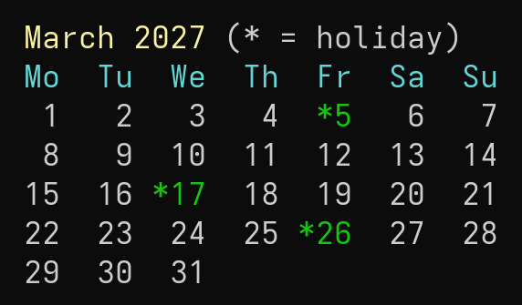

# ConsoleCalendarGenerator

A .NET library that lays out and renders month calendars for console applications: as plain text, as
structured segments you can style yourself, or straight to the console in color.

## Status

This page describes **version 2.0.0**.

- **Version 2.0.0** adds the modern API that most of this page describes. It keeps the legacy API
  (`CalendarGenerator.ConsoleCalendar`), with every signature unchanged, and corrects five things that API got
  wrong; see [Migrating from 1.0.0 to 2.0](#migrating-from-100-to-20).
- **Version 1.0.0** has the legacy API only.

Which versions are published is shown on the
[package's page on nuget.org](https://www.nuget.org/packages/ConsoleCalendarGenerator). Until 2.0.0 is listed
there, the newest published version is 1.0.0, and the modern API is used by building this repository; see
[Building and testing](#building-and-testing).

## Features

- A month as text that depends only on the options you pass: nothing is read from the current culture, the
  console or the clock.
- Titles and weekday labels in any culture you choose, or weekday labels of your own; any first day of the
  week.
- Marked dates that show in the text itself, with a marker such as `*`, so they never depend on color alone.
- Optional console colors through a theme.
- Output to any `TextWriter`, or to the console with the caller's colors put back afterwards.
- A structured result: every piece of text says what it is (title, weekday label, day, marked day), so you can
  render it your own way without parsing text.
- The layout on its own, if all you need is which day falls in which week and column.
- The 1.0.0 API, kept for existing code.

## Installation

```text
dotnet add package ConsoleCalendarGenerator
```

This installs the newest published version. Everything on this page is in version 2.0.0; version 1.0.0 has the
[legacy API](#legacy-api) only. If the command gives you 1.0.0, then 2.0.0 is not on nuget.org yet.

## Quick start

The examples assume a console project with implicit usings, plus these two:

```csharp
using System.Globalization;
using ConsoleCalendarGenerator;

MonthRenderOptions options = MonthRenderOptions.Default
    .WithCulture(CultureInfo.GetCultureInfo("en-US"))
    .WithWeekdayLabels(new[] { "Su", "Mo", "Tu", "We", "Th", "Fr", "Sa" });

RenderedMonth month = MonthRenderer.Render(2027, 3, options);

Console.WriteLine(month.ToText());
```

```text
     March 2027
Mo Tu We Th Fr Sa Su
 1  2  3  4  5  6  7
 8  9 10 11 12 13 14
15 16 17 18 19 20 21
22 23 24 25 26 27 28
29 30 31
```

Options are immutable. Start from `MonthRenderOptions.Default` and chain `With` methods; each returns a new
instance.

**Choose a culture.** The default culture is the invariant culture, so that the output does not depend on the
machine. Under it the title above would read `2027 March`. Pass the culture you want, as the example does.

**Supply the weekday labels** when the text has to be the same on every operating system, as the example does.
There are always seven, Sunday first, whichever day the week starts on. Without them the labels are the
culture's own day names, which differ between systems; see
[The culture's own day names](#the-cultures-own-day-names).

## Culture and first day of week

The culture decides the language of the title. The first day of the week is a separate choice: weeks start on
Monday unless you say otherwise, whatever the culture. Starting from the `options` of the quick start:

```csharp
MonthRenderOptions sundayFirst = options.WithFirstDayOfWeek(DayOfWeek.Sunday);

Console.WriteLine(MonthRenderer.Render(2027, 3, sundayFirst).ToText());
```

```text
     March 2027
Su Mo Tu We Th Fr Sa
    1  2  3  4  5  6
 7  8  9 10 11 12 13
14 15 16 17 18 19 20
21 22 23 24 25 26 27
28 29 30 31
```

To follow a culture's own convention, pass `culture.DateTimeFormat.FirstDayOfWeek`.

The grid is always the Gregorian calendar, and the title always names the Gregorian month and year it shows,
also for cultures whose own calendar is a different one.

### The culture's own day names

If you supply no labels, the culture supplies them as well as the title:

```csharp
MonthRenderOptions french = MonthRenderOptions.Default
    .WithCulture(CultureInfo.GetCultureInfo("fr-FR"));

Console.WriteLine(MonthRenderer.Render(2027, 3, french).ToText());
```

On Linux and macOS this prints:

```text
     mars 2027
lu ma me je ve sa di
 1  2  3  4  5  6  7
 8  9 10 11 12 13 14
15 16 17 18 19 20 21
22 23 24 25 26 27 28
29 30 31
```

On Windows the weekday row is ` L  M  M  J  V  S  D`. Both are right. The labels are the culture's shortest day
names as .NET reports them, and .NET takes them from the globalization data of the operating system, which
differs between systems and can change with their versions. For English the same happens: two letters on
Linux and macOS, one letter on Windows. Culture-derived labels are therefore not guaranteed to be identical
everywhere.

When they have to be, supply them:

```csharp
MonthRenderOptions frenchWithLabels = french
    .WithWeekdayLabels(new[] { "di", "lu", "ma", "me", "je", "ve", "sa" });

Console.WriteLine(MonthRenderer.Render(2027, 3, frenchWithLabels).ToText());
```

This prints the text shown above on every system.

## Marked dates

A `DayState` is a name and a marker. Days in that state show the marker directly before the day number.
Again starting from the `options` of the quick start:

```csharp
var holiday = new DayState("holiday", "*");
DateTime[] holidays = { new DateTime(2027, 3, 5), new DateTime(2027, 3, 17), new DateTime(2027, 3, 26) };

MonthRenderOptions withMarkers = options
    .WithCellWidth(3)
    .WithTitleSuffix(" (* = holiday)");

RenderedMonth month = MonthRenderer.Render(2027, 3, withMarkers, holidays, holiday);

Console.WriteLine(month.ToText());
```

```text
 March 2027 (* = holiday)
 Mo  Tu  We  Th  Fr  Sa  Su
  1   2   3   4  *5   6   7
  8   9  10  11  12  13  14
 15  16 *17  18  19  20  21
 22  23  24  25 *26  27  28
 29  30  31
```

- **The marker must fit in the cell** beside a two-digit day. The default cell is two wide and holds no marker;
  a one-character marker needs `WithCellWidth(3)`. A marker that does not fit is an error, never cut off.
- **Say what the marker means.** There is no built-in legend; `WithTitleSuffix` is a simple place for one.
- A date selects a day by its year, month and day. The time of day is ignored, and dates in other months are
  ignored.
- For several states, pass dates with their states, for example a `Dictionary<DateTime, DayState>`. A day has
  one state; when several entries name the same day, the first one decides.

## Colors

A `CalendarTheme` maps what is drawn to console colors. Colors add to the markers; they do not replace them.

```csharp
CalendarTheme theme = CalendarTheme.None
    .WithTitleColor(ConsoleColor.Yellow)
    .WithWeekdayLabelColor(ConsoleColor.Cyan)
    .WithStateColor("holiday", ConsoleColor.Green);

ConsoleMonthWriter.Write(month, theme);
```



- A theme has an optional color for the title, the title suffix, the weekday labels, the days, and each state
  by name. Anything without a color is written in the color the console already has.
- State names are matched exactly, including case. Calling `WithStateColor` again for the same name replaces
  the earlier color.
- A day whose state has no color uses the color of ordinary days.
- Only foreground colors are set.

## Output

**As a string.** `ToText()` joins the lines with `"\n"` on every platform and adds nothing after the last line.
`ToText("\r\n")` uses that terminator instead.

**To any `TextWriter`.** `MonthWriter` writes each line followed by the writer's own `NewLine`, including the
last line. It never touches the console.

```csharp
using var writer = new StringWriter();

MonthWriter.Write(month, writer);

string text = writer.ToString();
```

**To the console.** `ConsoleMonthWriter`, shown under [Colors](#colors), is the only modern type that uses the
console. It writes through `Console.Out`, sets only the foreground color, and before it returns puts back the
colors the console reported when it started, also when writing fails. Pass `CalendarTheme.None` to write
without colors.

Whether colors appear is up to the .NET runtime and the terminal. When output is redirected to a file or a
pipe, the text arrives plain.

## What each piece of text is

A rendered month is lines, and a line is segments. Each segment has its text, a kind, and for day cells the
date, the weekday and the state. To find the marked days, read the segments rather than the text:

```csharp
foreach (RenderedSegment segment in month.Lines.SelectMany(line => line.Segments))
{
    if (segment.State != null && segment.Date is DateTime date)
    {
        Console.WriteLine($"{date.DayOfWeek} {date.Day}: {segment.State.Name}, drawn as \"{segment.Text}\"");
    }
}
```

```text
Friday 5: holiday, drawn as " *5"
Wednesday 17: holiday, drawn as "*17"
Friday 26: holiday, drawn as "*26"
```

The kinds are `Indent`, `Padding`, `Title`, `TitleSuffix`, `WeekdayLabel`, `Gap`, `EmptyDay` and `Day`. The
segments of a line, joined in order, are exactly the line. `CalendarTheme.GetColor(segment)` gives the color a
theme assigns to a segment, which is all you need to draw a month in a user interface of your own.

## Layout only

`MonthLayout` answers where the days of a month go, with no text involved:

```csharp
MonthLayout layout = MonthLayout.Create(2027, 4, DayOfWeek.Monday);

Console.WriteLine($"April 2027 needs {layout.Weeks.Count} weeks. Its first week:");
foreach (MonthLayoutCell cell in layout.Weeks[0].Cells)
{
    Console.WriteLine($"  {cell.DayOfWeek}: {(cell.Date is DateTime date ? $"the {date.Day}" : "empty")}");
}
```

```text
April 2027 needs 5 weeks. Its first week:
  Monday: empty
  Tuesday: empty
  Wednesday: empty
  Thursday: the 1
  Friday: the 2
  Saturday: the 3
  Sunday: the 4
```

`MonthRenderer` uses the same layout; use `MonthLayout` directly when you draw the month yourself.

## More options

| Option | Default | Notes |
|---|---|---|
| `WithCulture` | invariant culture | Language of the title and the labels |
| `WithFirstDayOfWeek` | Monday | Never taken from the culture |
| `WithWeekdayLabelStyle` | `Shortest` | Or `Abbreviated`; the culture's day names, as the system has them |
| `WithWeekdayLabels` | none | Seven labels of your own, Sunday first; the same on every system |
| `WithCellWidth` | 2 | 2 to 100; days and labels are right-aligned |
| `WithColumnGap` | 1 | 0 to 100 spaces between columns |
| `WithIndent` | none | Text before every line |
| `WithTitleFormat` | `"Y"` | Any .NET date format string, such as `"MMMM yyyy"` |
| `WithTitleSuffix` | none | Text directly after the title |
| `WithTitleAlignment` | `Center` | Or `Left` |

A label longer than its cell is cut to fit, so the grid keeps its shape in every language. Widths are counted
in text elements (user-perceived characters); how many columns a terminal uses for a character is outside what
the library can know.

## Legacy API

`CalendarGenerator.ConsoleCalendar` is the API of version 1.0.0. Version 2.0.0 keeps it and supports it. It
is not obsolete: every constructor, method and parameter name is unchanged, and a program compiled against
1.0.0 loads the new assembly without being rebuilt. For new code, use the modern API above.

```csharp
// The legacy class takes the month name from the current culture of the process.
CultureInfo.CurrentCulture = CultureInfo.GetCultureInfo("en-US");

var calendar = new CalendarGenerator.ConsoleCalendar();
calendar.SetTitleColor(ConsoleColor.Yellow);
calendar.SetSelectedDateColor(ConsoleColor.Green);

calendar.GenerateMonth(3, 2027, new List<DateTime> { new DateTime(2027, 3, 17) });
```

```text
    March 2027
Mo Tu We Th Fr Sa Su
 1  2  3  4  5  6  7
 8  9 10 11 12 13 14
15 16 17 18 19 20 21
22 23 24 25 26 27 28
29 30 31
```

What to know about it:

- It writes straight to the console and returns nothing. A selected date differs by color only.
- Weeks start on Monday and the weekday row is always English.
- It resets the console's colors when it is done; it does not put the caller's colors back.
- `GenerateYear` draws the twelve months of a year one after the other.
- Prefer the parameterless constructor and the four `Set` methods, as in the example. They set the color they
  are named for in every version.

The XML documentation of the class describes the rest. In five places it behaves differently from 1.0.0; the
next section lists them.

## Migrating from 1.0.0 to 2.0

Version 2.0 is a major version because it makes five corrections to what `CalendarGenerator.ConsoleCalendar`
did in 1.0.0. The public API of that class does not change, so a program written for 1.0.0 compiles and loads
as before; what can change is what it draws or throws in the five cases below. A program that none of them
touches needs no change. The modern API is new and has nothing to migrate.

### What changed

1. **Constructor colors.** In the constructors that take colors, each argument now colors what it is named
   for: `TitleColor` the title, `DateColor` the days, `SelectedDateColor` the selected days and
   `DayOfWeekColor` the weekday row. In 1.0.0, `TitleColor` colored the weekday row, the title stayed yellow,
   and with four arguments `DayOfWeekColor` colored the title.
   - **One, two or three arguments:** the title is now drawn in the first color, where it was yellow, and the
     weekday row in cyan, where it had the first color.
   - **Four arguments:** the first and the fourth color trade places. To keep what the program drew, pass
     those two in each other's place.
   - **The parameterless constructor and the `Set` methods are unchanged.** A program that uses them draws the
     same with both versions.
   - A value that is not a defined `ConsoleColor` is still accepted and still fails only when its element is
     first drawn. For the first and the fourth argument that is now another element, so the failure comes at
     another point.
2. **A null list of dates.** `GenerateMonth` and `GenerateYear` now throw `ArgumentNullException`, naming the
   parameter `dates`, when the list is `null`. In 1.0.0 they threw `NullReferenceException`. The list is
   checked before the month and the year, and before anything is written. Catch the new exception, or pass an
   empty list, which selects no dates.
3. **Line endings.** Every line now ends with the line terminator of the console's writer, the last row of
   days of a month included. In 1.0.0 that row ended with a bare line feed whatever the terminator was. On
   Windows the output therefore no longer mixes LF and CRLF. Where the terminator is a line feed, as on Linux
   and macOS, the text is the same as before.
4. **One blank line after every month.** Every month is now followed by exactly one blank line. In 1.0.0 a
   month whose last day is a Sunday was followed by two. Such a month is one line shorter, and so is a year
   for each such month in it.
5. **The title names the Gregorian month.** The title is now the current culture's name for the Gregorian
   month that is drawn. In 1.0.0 it was the culture's name for the month of the same number in the culture's
   own calendar. Under nearly every culture that is the same name and nothing changes. Under a culture whose
   calendar is another one, such as `fa-IR` where the system gives it the Persian calendar, the title named a
   different month than the days below it. The language still comes from `CultureInfo.CurrentCulture`, and the
   year in the title is still the number you pass. The title is indented by the length of the name as before,
   so it can start a column or two further left or right where the two names differ in length.

A program that counts lines, or compares the output with stored text, has to allow for points 3 to 5.

### What did not change

- Every public signature and every parameter name, the namespace `CalendarGenerator` and the type name
  `ConsoleCalendar`. Nothing is removed, and nothing is marked obsolete.
- `GenerateYear`, and the four `Get` and four `Set` methods.
- Which dates are selected: a date selects the day with the same year, month and day.
- The weekday row, `Mo Tu We Th Fr Sa Su` in English, and weeks that start on Monday.
- Writing directly to the console, resetting its colors afterwards instead of putting the caller's colors
  back, and taking no lock: drawing from several threads at once still mixes their output.
- The modern API. It is new in this version, so no earlier program depends on it.

## Supported frameworks

The package contains two builds of the library, and NuGet picks the right one for your project:

| Build | Used by |
|---|---|
| `net10.0` | Projects that target .NET 10 or later |
| `netstandard2.1` | Projects that target another framework implementing .NET Standard 2.1, such as .NET 8 |

The two builds have the same API and the same behavior. The library has no dependencies. It is built and
tested on Linux, Windows and macOS.

## Limitations

- One month at a time. The modern API has no year view; the legacy `GenerateYear` still exists.
- Day names taken from a culture are what the system's globalization data says, so they are not guaranteed
  to be identical on every operating system. Labels you supply are. See
  [The culture's own day names](#the-cultures-own-day-names).
- A day has at most one state.
- The Gregorian calendar only.
- Colors are the sixteen `ConsoleColor` values, foreground only. The library writes no escape sequences of its
  own.
- That the console's colors are put back after writing is verified by tests on Linux and macOS. On Windows the
  same code runs, but the test environment cannot read console colors, so it is not verified there.

## Building and testing

You need the .NET SDK named in
[global.json](https://github.com/ShaunAnthonyHathaway/ConsoleCalendarGenerator/blob/v2.0.0/global.json).

```text
dotnet build ConsoleCalendarGenerator.sln --configuration Release
dotnet test ConsoleCalendarGenerator.Tests/ConsoleCalendarGenerator.Tests.csproj --configuration Release --filter "TestCategory!=Terminal"
dotnet run --project ConsoleCalendarGeneratorExample
```

The last command runs the
[example program](https://github.com/ShaunAnthonyHathaway/ConsoleCalendarGenerator/tree/v2.0.0/ConsoleCalendarGeneratorExample),
which is where every example on this page comes from. More, including how to pack and check the package, is in
[CONTRIBUTING.md](https://github.com/ShaunAnthonyHathaway/ConsoleCalendarGenerator/blob/master/CONTRIBUTING.md).

## Project

- [Changelog](https://github.com/ShaunAnthonyHathaway/ConsoleCalendarGenerator/blob/master/CHANGELOG.md)
- [Contributing](https://github.com/ShaunAnthonyHathaway/ConsoleCalendarGenerator/blob/master/CONTRIBUTING.md)
- [Security](https://github.com/ShaunAnthonyHathaway/ConsoleCalendarGenerator/blob/master/SECURITY.md)
- Questions and bug reports: [GitHub issues](https://github.com/ShaunAnthonyHathaway/ConsoleCalendarGenerator/issues)

## License

[MIT](https://github.com/ShaunAnthonyHathaway/ConsoleCalendarGenerator/blob/master/LICENSE)
